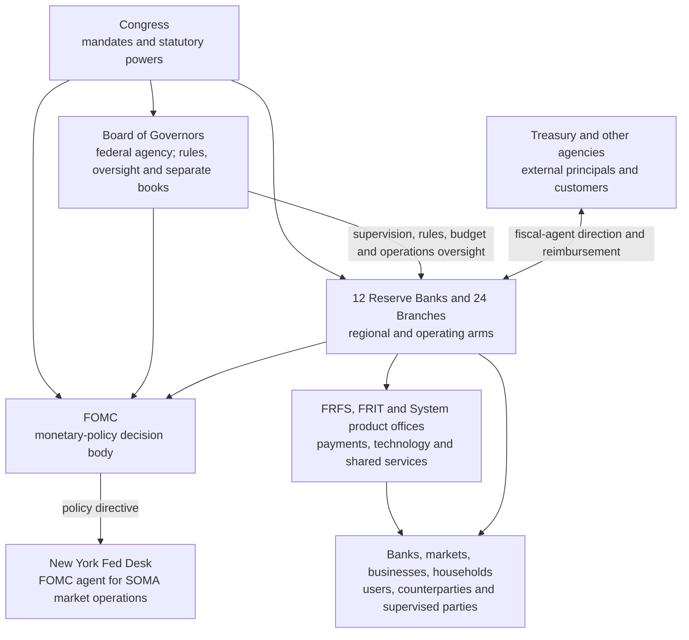

# Federal Reserve — actual job and operating story

**Status:** pending workbench research; not yet promoted to the vault  
**Updated:** July 25, 2026  
**Evidence cutoff:** official records available through July 25, 2026  
**Scope:** the Federal Reserve's stated mission, legal and operating actors,
day-to-day work, public workload measures, staffing proxies and the relationship
between functional budgets and audited 2025 uses of money  
**Dollar convention:** every monetary amount is written in full nominal
dollars. Amounts expanded from source-rounded figures do not gain additional
precision.

This is a factual operating map. It does not assume that every stated function
is performed efficiently or that the disclosed expense is necessary. It first
reconstructs the Federal Reserve's own institutional story so that later
questions about cost, control, duplication and recipient concentration begin
from the correct entities and accounting objects.

## I. Bottom line

The Federal Reserve's actual claimed job is much broader than setting an
interest rate and printing money.

The Fed describes five public functions:

1. conduct monetary policy;
2. promote financial-system stability;
3. supervise and regulate financial institutions and activities;
4. foster payment-and-settlement-system safety and efficiency; and
5. promote consumer protection and community development.

Its operating arms also perform a major sixth service lane that is partly
nested inside the payment function:

6. act as banker and fiscal agent for the United States Treasury and other
   government entities.

Underneath those public functions is a large support structure: economics and
market staff, bank examiners, payment operators, cash operations, software and
cybersecurity teams, lawyers, accountants, facilities, procurement, human
resources, pensions and shared-service organizations.

The cleanest first conclusion is:

> **The policy decision is small; the implementation, supervision, settlement,
> fiscal-agent and information infrastructure is large.**

But a second conclusion is just as important:

> **The enormous monetary-balance-sheet flows do not measure what it costs to
> run that infrastructure.**

In 2025, the 12 combined Reserve Banks recognized $167,381,000,000 of interest
expense on reserve, deposit and repo liabilities, compared with
$9,800,000,000 of operating expenses and assessments. The interest expense was
the consequence of the monetary-policy implementation framework. It was not a
payroll, building, software, research or grant budget.

## II. The three clocks used in this map

The public record does not yet provide one 2025 table that allocates every
actual dollar by function. This map therefore keeps three different clocks
visible:

| Clock | What it answers | Public evidence used |
|---|---|---|
| 2024 actual functional clock | Which operating functions consumed resources? | Latest published System budget-review actuals |
| 2025 budget clock | What did the Board and Reserve Banks say they planned to emphasize? | 2025 Board and Reserve Bank budgets |
| 2025 audited accounting clock | What expense classes and balance-sheet uses were actually recognized? | 2025 Board and combined Reserve Bank audited statements |

The 2025 budget is an authorization ceiling, not proof of spending. The 2025
audited statements are actual accounting records, but their expense classes do
not provide the same function-by-function detail as the budget review.

## III. Who actually does what

### Board of Governors

The Board is a federal agency with separate audited books. It:

- participates in monetary-policy formulation;
- writes and administers regulations;
- supervises large and other covered institutions with the Reserve Banks;
- oversees the Reserve Banks and major payment systems;
- approves Reserve Bank budgets and certain major capital projects;
- assesses the Reserve Banks for Board operations, capital, currency and CFPB
  funding;
- orders Federal Reserve notes from Treasury's Bureau of Engraving and
  Printing; and
- maintains Board-wide economics, financial-stability, legal, consumer,
  statistics, technology and administrative staffs.

### Federal Open Market Committee

The FOMC is the statutory policy committee, not a conventional operating
company with its own public payroll and property balance sheet. Its members
decide the stance of monetary policy and direct open-market implementation.
Board and Reserve Bank staffs prepare forecasts, market analysis, regional
intelligence, briefing material and implementation options for that process.

### Twelve Reserve Banks

The Reserve Banks are separately incorporated operating institutions. They:

- maintain reserve and settlement accounts for depository institutions;
- lend through the discount window and operate authorized liquidity
  facilities;
- supervise and examine covered institutions;
- operate cash, check, ACH, Fedwire, National Settlement and FedNow services;
- act as depositories and fiscal agents for Treasury;
- collect regional economic intelligence and conduct research;
- maintain local premises and staff; and
- host national product, technology and employee-benefit functions whose costs
  may be allocated across all 12 Banks.

### New York Fed and the SOMA Desk

The New York Fed conducts open-market operations as agent for the FOMC and all
12 Reserve Banks. It transacts in Treasury and agency securities, agency
mortgage-backed securities, repo and reverse repo markets, operates securities
lending and handles foreign-official and international-account activity.

The assets and results are participated across the Reserve Banks through the
System Open Market Account. New York's operational role therefore should not be
mistaken for sole economic ownership of the portfolio.

### Shared-service organizations

The System is not simply 12 Banks duplicating every function:

- Federal Reserve Financial Services coordinates national payment products;
- Federal Reserve Information Technology, hosted within the Richmond
  structure, supplies national infrastructure and business-line technology;
- product and function offices can be hosted at one Bank while serving and
  charging all Banks; and
- Atlanta hosts the Office of Employee Benefits for System benefit-plan
  administration.

These arrangements create inter-Bank charges, reimbursements and accounting
ownership that disappear or net in the combined 12-Bank statements.

### Treasury and the Bureau of Engraving and Printing

Treasury has multiple, nonidentical relationships with the Fed:

- issuer of Treasury securities held in SOMA;
- holder of the Treasury General Account;
- principal and reimbursing customer for fiscal-agent work;
- recipient of Reserve Bank residual earnings when remittances are available;
  and
- parent department of the Bureau of Engraving and Printing.

The Bureau of Engraving and Printing physically prints Federal Reserve notes.
The Board is the issuing authority, orders the notes and pays currency costs
through assessments on the Reserve Banks; the Reserve Banks put notes into
circulation, distribute, process, authenticate and destroy them.

## IV. What the work looks like in practice

### 1. Monetary policy and implementation

The visible FOMC vote is the end of a recurring production process:

- collect and revise economic, banking, labor, price and market data;
- produce national and regional forecasts;
- interview businesses and communities and prepare regional intelligence;
- model policy alternatives and financial conditions;
- brief governors and Reserve Bank presidents;
- publish statements, minutes, projections, reports and data;
- implement the directive through interest on reserve balances, repo and
  reverse-repo facilities, open-market operations and the SOMA portfolio; and
- maintain lending, collateral, counterparty, settlement and risk systems.

The New York Desk implements the FOMC's directive. The current framework
primarily steers short-term rates using interest on reserve balances and the
overnight reverse-repurchase facility, with other tools available.

### 2. Financial stability

The Fed says it monitors four broad vulnerability areas: asset valuations,
household and business borrowing, financial-sector leverage and funding risk.
Staff perform quarterly assessments, prepare the semiannual Financial
Stability Report, contribute to stress scenarios and coordinate with the
Financial Stability Oversight Council, the Financial Stability Board and
foreign authorities.

This lane overlaps economics, markets and supervision. It is not a separately
operated emergency response office whose costs can be read from a single
expense line.

### 3. Supervision and regulation

This is a large recurring field-and-analysis operation. Work includes:

- examinations and continuous monitoring;
- capital, liquidity, governance, operational resilience, information
  technology, cybersecurity, consumer-compliance and anti-money-laundering
  reviews;
- applications for mergers, acquisitions, memberships and other corporate
  actions;
- rulemaking, guidance and supervisory policy;
- stress testing and large-firm capital work;
- enforcement and remediation monitoring; and
- collection and analysis of regulatory data.

During 2024, the Fed reported:

| Supervision output | Count |
|---|---:|
| State member bank examinations conducted by the Federal Reserve | 316 |
| Bank holding company inspections | 2,894 |
| Savings-and-loan holding company inspections | 120 |
| Foreign-bank examinations in which the Fed conducted or participated | 678 |
| Consumer-compliance examinations completed by Reserve Banks | 394 |
| Formal enforcement actions completed | 58 |
| Informal enforcement actions completed by Reserve Banks | 113 |

Those counts do not measure examination depth or staff hours, but they show
that supervision is a continuous operating line rather than an occasional
policy meeting.

### 4. Payments, accounts, settlement and cash

The Fed is both overseer and operator. It maintains institution accounts and
operates or supports:

- FedACH;
- Fedwire Funds;
- Fedwire Securities;
- National Settlement Service;
- FedNow;
- commercial check processing;
- FedLine access;
- currency and coin distribution; and
- principal, interest and securities settlement for fiscal-agent issuers.

Selected 2024 public workload measures were:

| Service | 2024 reported workload |
|---|---|
| FedACH commercial service | 20,100,000,000 transactions; average daily value $169,300,000,000 |
| Fedwire Funds | approximately 210,000,000 transfers; average daily value $4,500,000,000,000 |
| Commercial checks | 2,980,000,000 checks; average daily value $32,600,000,000 |
| Fedwire Securities | approximately 28,900,000 transfers; average daily value more than $2,200,000,000,000 |
| Fedwire Securities principal and interest payments | $37,900,000,000,000 |
| Securities held in Fedwire Securities accounts at year-end | approximately $114,000,000,000,000 par value |

Transaction value is not Fed revenue or expense. It is workload flowing
through infrastructure the Fed operates.

### 5. Treasury fiscal-agent work

Reserve Banks support Treasury payments, collections, cash forecasting,
accounting, debt auctions, marketable and savings securities, retail-investor
servicing and government financial systems.

Selected 2024 workload measures were:

| Treasury service | 2024 workload |
|---|---|
| Treasury payments processed through FedACH | nearly 1,800,000,000 payments valued at approximately $8,500,000,000,000 |
| Wholesale Treasury marketable-securities auctions | 440 auctions awarding $28,500,000,000,000 |
| Marketable securities issued and serviced for retail investors | $612,000,000,000 |
| U.S. savings bonds issued and serviced | $18,000,000,000 |

Treasury and other government principals reimburse this lane. The 2025
combined Reserve Bank statements reported $934,000,000 of reimbursable-service
income. The latest detailed 2024 table showed $859,322,000 of reimbursable
cost, including $847,392,000 attributable to Treasury.

The reimbursed cost is real operating work but is not a permanent use of
Reserve Bank portfolio income.

### 6. Consumer protection and community development

Work includes consumer-compliance examinations, fair-lending and Community
Reinvestment Act activity, complaints and inquiries, consumer and household
research, community-development analysis and outreach.

Federal Reserve Consumer Help processed 34,198 cases in 2024:

- 17,237 inquiries; and
- 16,961 complaints.

Complaints against Federal Reserve-regulated entities totaled 9,700. Those
counts do not capture community-development research, convenings or policy
work, but they identify one concrete operating queue.

### 7. Internal support

The public-facing functions depend on:

- information technology, cloud infrastructure and cybersecurity;
- data acquisition, statistics, modeling and data governance;
- legal, finance, audit and records work;
- human resources, compensation and pensions;
- procurement, travel and communications;
- facilities, physical security and currency logistics; and
- national governance, committees and shared-service allocations.

These are not separate congressional missions. They are the support layer
through which the five functions and fiscal-agent work operate.

## V. What the latest functional spending says

### Reserve Banks: latest actual functional view

The 2024 functional actuals are the latest published actual allocation by
Reserve Bank operating area:

| Reserve Bank operating area | 2024 actual expense | 2025 budget |
|---|---:|---:|
| Monetary and economic policy | $902,900,000 | $961,100,000 |
| Services to Treasury and other government agencies | $774,600,000 | $852,000,000 |
| Services to financial institutions and the public, including cash | $1,712,500,000 | $1,870,100,000 |
| Supervision and regulation | $1,732,500,000 | $1,902,000,000 |
| Fee-based services to financial institutions | $742,700,000 | $797,400,000 |
| **Total** | **$5,865,400,000** | **$6,382,500,000** |

This presentation excludes pension costs, reimbursements and Board operating
expenses. It therefore cannot be reconciled one-for-one to the
$9,800,000,000 audited 2025 operating-and-assessment block.
Individual functional lines were rounded by the source before being expanded
to full dollars, so they may not add exactly to the displayed source total.

The important ordering is:

1. supervision and regulation;
2. services to financial institutions and the public;
3. monetary and economic policy;
4. Treasury and other government services; and
5. fee-based payment services.

Thus, on the Fed's own latest actual functional presentation, the Reserve Banks
spent more on supervision and more on public/financial-institution services
than on monetary and economic policy.

### Board: latest actual functional view

| Board operating area | 2024 actual expense | 2025 budget |
|---|---:|---:|
| Monetary policy and financial stability | $449,400,000 | $518,500,000 |
| Supervision and regulation | $438,000,000 | $465,700,000 |
| Payment system and Reserve Bank oversight | $87,200,000 | $89,800,000 |
| Consumer protection and community development | $75,400,000 | $94,600,000 |
| **Total Board operations** | **$1,049,900,000** | **$1,168,600,000** |

This functional table allocates central support across the four operating
areas. A different division table shows the organizational machinery behind
them:

| Selected Board division or office | 2024 actual expense | 2025 budget |
|---|---:|---:|
| Management | $200,900,000 | $218,800,000 |
| Information Technology | $187,500,000 | $209,900,000 |
| Supervision and Regulation | $139,800,000 | $152,300,000 |
| Research and Statistics | $117,300,000 | $125,300,000 |
| Reserve Bank Operations and Payment Systems | $55,600,000 | $59,700,000 |
| Monetary Affairs | $55,200,000 | $58,900,000 |
| International Finance | $47,700,000 | $55,900,000 |
| Consumer and Community Affairs | $43,400,000 | $47,600,000 |
| Legal | $40,900,000 | $44,300,000 |
| Financial Stability | $23,500,000 | $26,900,000 |

The operating-area and division tables are two lenses on the same Board
budget. They must not be added together.
Individual 2024 operating-area lines were rounded by the source before being
expanded, so they add to $1,050,000,000 while the source reports a
$1,049,900,000 total.

## VI. What the 2025 audited money says

### The largest dollars: monetary liabilities

| 2025 combined Reserve Bank expense | Actual amount |
|---|---:|
| Interest on reserve balances and other eligible deposits | $147,662,000,000 |
| Interest on reverse repos with foreign official and international accounts | $15,267,000,000 |
| Interest on reverse repos with primary dealers and expanded counterparties | $4,452,000,000 |
| **Total interest expense** | **$167,381,000,000** |
| **Reserve Bank operating expenses and assessments** | **$9,800,000,000** |

This is why the Fed's gross income and gross expense cannot be treated like the
revenue and overhead of an ordinary organization. Most 2025 recognized expense
was the rate paid on monetary liabilities.

### What operating money bought

| 2025 combined Reserve Bank operating block | Actual amount |
|---|---:|
| Salaries and benefits | $4,442,000,000 |
| System pension service cost | $577,000,000 |
| Occupancy | $352,000,000 |
| Equipment | $286,000,000 |
| Other, including software amortization and professional services | $1,196,000,000 |
| Board operations and currency assessments | $2,702,000,000 |
| CFPB assessment | $245,000,000 |
| **Total** | **$9,800,000,000** |

The Board's separate audited 2025 operating expenses were $1,191,822,781. The
largest components were:

| Board 2025 expense class | Actual amount |
|---|---:|
| Salaries and contractual staffing fees | $711,564,701 |
| Retirement, insurance and benefits | $142,564,215 |
| Contractual and professional fees | $61,346,020 |
| Depreciation, amortization and net disposal results | $54,626,657 |
| Software | $47,177,950 |
| Data, news and research | $44,291,812 |
| Rentals of space and equipment | $38,118,539 |

These Board expenses are not additional to the full Reserve Bank assessment
line on a simple cash basis. Reserve Bank assessments fund Board operations,
capital and other pass-throughs, and the Board reported its own revenue,
expenses, capital spending and retained results separately.

## VII. What the staffing proxy says about time

The public budget does not publish a System-wide employee-hour or FTE
allocation across the five functions. It therefore does not answer exactly
how much staff time was spent on monetary policy, supervision, payments or
support.

The best high-level proxy is:

| Employment measure | 2024 actual FTE | 2025 budgeted FTE |
|---|---:|---:|
| Board | 3,176 | 3,291 |
| Office of Inspector General | 140 | 146 |
| Reserve Banks, including Federal Reserve Information Technology | 20,840 | 21,411 |
| Currency | 23 | 27 |
| **Total System** | **24,179** | **24,875** |

Within the 2025 Reserve Bank budget:

- 19,622 FTE were assigned to the 12 District structures; and
- 1,789 FTE were assigned to Federal Reserve Information Technology.

The Board's division table separately budgeted 438 positions for Information
Technology, 499 for Supervision and Regulation, 370 for Research and
Statistics, 192 for Monetary Affairs and 172 for International Finance.
Positions and FTE are different measures and should not be combined.

The public record therefore supports:

> **A large workforce is verified; a precise public allocation of all staff
> time by mission is not.**

## VIII. What it says is driving growth

The Fed's 2025 budget narrative identifies these resource drivers:

- regional economic research and market-operation monitoring;
- supervision portfolio growth;
- payment-infrastructure modernization;
- FedNow operations;
- Fedwire Funds migration to ISO 20022;
- FedLine software and connectivity;
- cloud migration for Federal Reserve Financial Services;
- the Accelerate Cloud and Colocation program;
- the Common Data Platform;
- Treasury-requested modernization and cloud migration of fiscal-agent
  applications;
- NextGen currency-processing machines and sensors;
- cash-vault and cash-center projects;
- Board forecasting, modeling, statistics and data infrastructure;
- cybersecurity and operational resilience; and
- the triennial Survey of Consumer Finances.

These are the institution's stated explanations. They identify programs and
purposes, not proof that the price, staffing level or delivery model is
optimal.

## IX. The Fed's story, reconciled

### Story 1: “We set interest rates”

True but incomplete. The FOMC sets the policy stance. Research, forecasting,
regional intelligence, market operations, reserve accounts, collateral,
payment systems and public communication make that stance operational.

### Story 2: “We print money”

Imprecise in two ways:

- Treasury's Bureau of Engraving and Printing physically prints notes; the
  Board is the issuing authority and orders them, while the Reserve Banks put
  them into circulation, distribute and process them.
- Balance-sheet “money creation” occurs through reserve-account and asset
  operations, not through the administrative budget.

### Story 3: “The portfolio funds the Fed”

Mechanically true but easy to misread. Reserve Bank earnings ordinarily cover
expenses, dividends and remittances. The size of the portfolio is determined
by monetary-policy and currency factors, not by adding up the desired cost of
employees, buildings and software.

In 2025, the portfolio produced $155,299,000,000 of interest income while the
Reserve Banks paid $167,381,000,000 of interest expense. The System did not
need a large positive profit to keep operating; instead, its deferred
Treasury-remittance asset increased because current earnings were insufficient
to cover current expenses and restore prior remittance capacity.

### Story 4: “We are a public institution”

The Board is a federal agency. The Reserve Banks are separately incorporated
statutory bodies with public functions and limited member-bank stock. The
System is federally created and publicly purposed, but it is not one ordinary
department, one private corporation or one consolidated legal entity.

### Story 5: “We spend mainly on economics and research”

Not supported by the latest functional actuals. Research and policy are
material, but Reserve Bank supervision, payments, cash, institution services
and fiscal-agent operations together are larger.

The identified 2024 internal research/policy functions totaled
$1,146,600,000:

| Internal research/policy line | 2024 actual |
|---|---:|
| Reserve Bank monetary and economic policy | $902,900,000 |
| Board Research and Statistics | $117,300,000 |
| Board International Finance | $47,700,000 |
| Board Monetary Affairs | $55,200,000 |
| Board Financial Stability | $23,500,000 |
| **Total** | **$1,146,600,000** |

That amount includes employees, data, forecasts, modeling, FOMC support and
market analysis. It is not an outside university, nonprofit or grant total.

## X. What the public story still does not show

The published record still does not provide:

- 2025 actual Reserve Bank expense by function;
- System-wide staff hours or FTE by function and support layer;
- a complete cost-center ledger connecting every function to payroll,
  software, data, contractors and facilities;
- a full vendor and payee ledger;
- application-level software ownership, users, invoices and inter-Bank
  allocations;
- the gross inter-Bank shared-service charges eliminated in combination;
- a clean split of internal research, purchased data, outside consulting,
  conferences, visiting scholars, universities, nonprofits and grants;
- recipient-level interest paid on reserve balances and reverse repos; or
- actual project-level cash spending for every capital program.

These are disclosure limits, not evidence that the undisclosed relationships
are improper.

## XI. Working storyline

The institution's own records support this provisional storyline:

> Congress created a federated central-bank system whose visible policy
> committee is only the top of the stack. Under it sits a national
> information, supervision, settlement, cash, lending and fiscal-agent
> network. The Reserve Banks do most operating work; the Board sets rules,
> oversees and supplies central policy staff; New York executes market
> operations; and shared-service offices distribute technology and product
> costs across the Banks.

> The largest dollars on the financial statements are generated by the
> monetary balance sheet and flow mainly between Treasury and agency assets,
> reserve-account holders and repo counterparties. The largest ordinary
> operating resources go to people, supervision, payment/cash services,
> software and support. Those two scales intersect, but they are not the same
> thing.

The next useful audit is therefore not “Why does interest-rate setting cost
$177,181,000,000?” It is:

1. Which functions account for the 24,875 budgeted System FTE?
2. Which outside vendors and hosted System offices receive the technology,
   data, professional-services and capital dollars?
3. Which costs are reimbursed by Treasury or financial-institution fees?
4. Which inter-Bank allocations vanish in the combined statements?
5. Which functions, systems or facilities duplicate work already performed by
   Treasury, other regulators or private payment networks?
6. What measurable output or risk reduction does each material program buy?

## XII. Primary-source spine

- [Federal Reserve Purposes & Functions](https://www.federalreserve.gov/monetarypolicy/pf.htm)
- [The Fed Explained — system structure and operating arms](https://www.federalreserve.gov/aboutthefed/fedexplained/who-we-are.htm)
- [Strategic Plan 2024–27](https://www.federalreserve.gov/publications/2024-27-strategic-plan.htm)
- [2024 actual and 2025 budgeted System expenses and employment](https://www.federalreserve.gov/publications/2024-ar-federal-reserve-system-budgets.htm)
- [2024 payment-system and fiscal-agent operations](https://www.federalreserve.gov/publications/2024-ar-payment-system-and-reserve-bank-oversight.htm)
- [2024 supervision and regulation operations](https://www.federalreserve.gov/publications/2024-ar-supervision-and-regulation.htm)
- [2024 consumer and community affairs operations](https://www.federalreserve.gov/publications/2024-ar-consumer-and-community-affairs.htm)
- [2024 financial-stability operations](https://www.federalreserve.gov/publications/2024-ar-financial-stability.htm)
- [New York Fed domestic market operations](https://www.newyorkfed.org/markets/domestic-market-operations)
- [2025 combined Reserve Bank audited financial statements](https://www.federalreserve.gov/aboutthefed/files/combinedfinstmt2025.pdf)
- [2025 Board of Governors audited financial statements](https://oig.federalreserve.gov/reports/board-financial-statement-audit-mar2026.pdf)
- [2025 Board budget](https://www.federalreserve.gov/foia/files/2025boardbudget.pdf)
